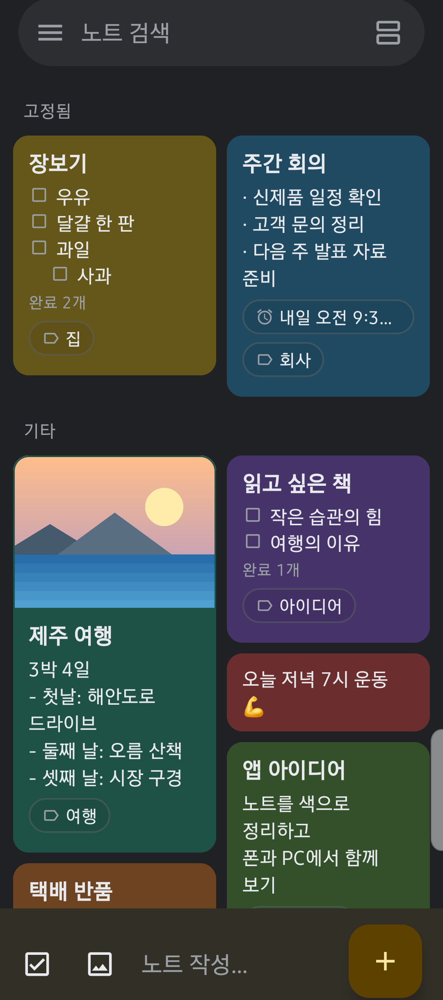
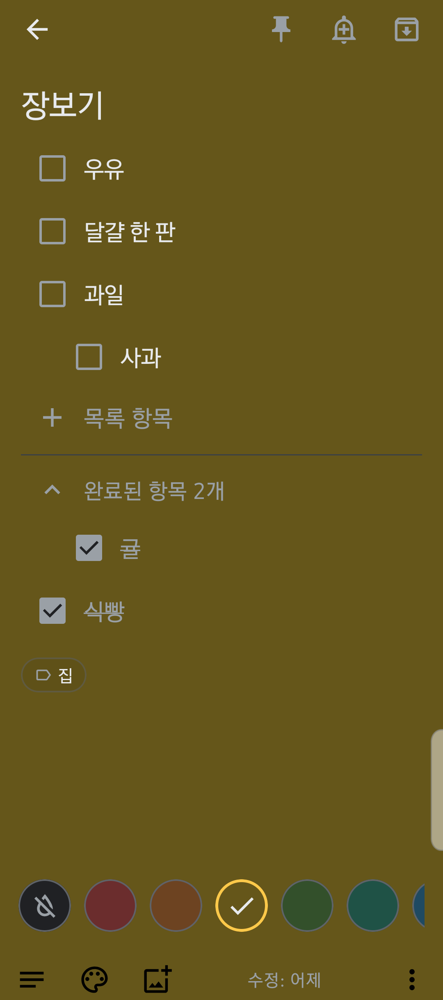
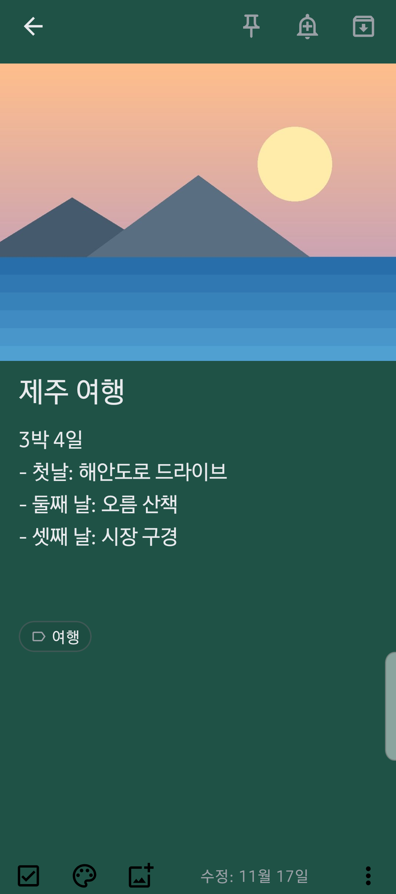
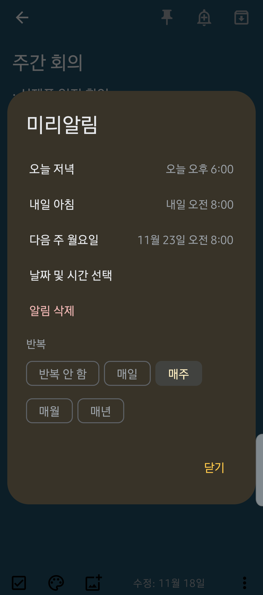
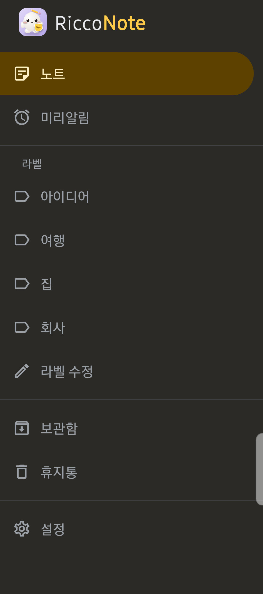
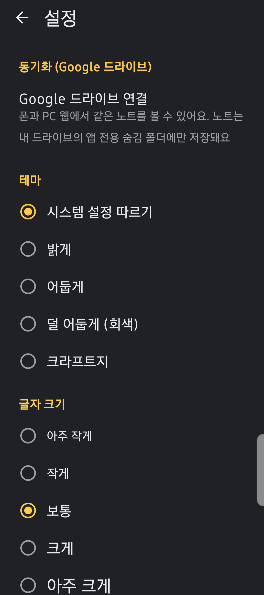
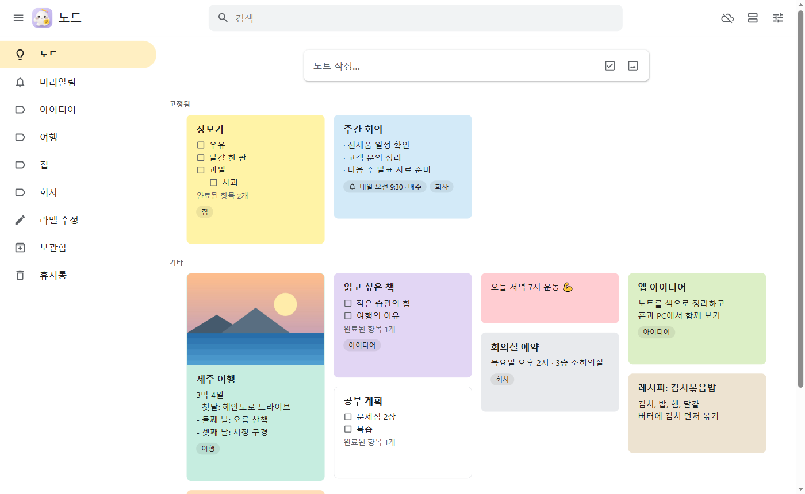

# RiccoNote

**노트와 체크리스트를 카드로 모아 보는 Android 노트 앱 + PC 웹 버전**

떠오른 생각, 장보기 목록, 회의 메모를 색깔 카드로 정리하세요.
광고 없음 · 회원가입 없음 · 인앱결제 없음 · 내 Google 드라이브로 폰과 PC 동기화.

  
  
  

  
  
  

*화면은 예시 데이터로 촬영했습니다.*

## 다운로드

**[최신 버전 APK 받기 (Releases)](https://github.com/pjh3152/RiccoNote-app/releases/latest)**

`Assets` 항목의 **RiccoNote-1.0.5.apk**를 받아 설치하면 됩니다.

- 지원 기기: **Android 8.0 (Oreo) 이상**
- 처음 설치할 때 브라우저나 파일 앱의 ‘출처를 알 수 없는 앱 설치’를 허용해야 할 수 있습니다.
- 새 버전은 덮어 설치하면 노트와 설정이 유지됩니다. 앱을 지우고 설치하면 폰 안의 노트도 지워집니다 (드라이브를 연결해 두었다면 다시 연결해서 받아 올 수 있습니다).
- 미리알림을 사용하려면 알림 권한을 허용해 주세요.

☕ 앱이 마음에 드셨다면 [카카오페이로 커피 한 잔 응원하기](https://qr.kakaopay.com/FbUYe4tN3)

## 💻 PC 웹 버전

**[https://pjh3152.github.io/RiccoNote-web/](https://pjh3152.github.io/RiccoNote-web/)**

설치 없이 PC 브라우저에서 바로 씁니다. 앱과 같은 Google 계정으로 드라이브를 연결하면 **폰과 같은 노트**가 보이고, 어느 쪽에서 고쳐도 몇 초~몇 분 안에 맞춰집니다. 웹만 따로 써도 됩니다.

- 노트·체크리스트·색·라벨·고정·보관·휴지통·사진·검색·끌어서 순서 바꾸기·글자 크기·테마
- 한 번 로그인하면 창을 닫았다 열어도 로그인이 유지됩니다
- 미리알림 시간은 웹에서도 정할 수 있지만, 알림은 폰 앱에서 울립니다
- 공용 PC에서는 쓰고 나서 설정 → **연결 해제**를 눌러 주세요 (그 브라우저에 남은 노트 사본도 지웁니다)

## 주요 기능

### 쓰고 정리하기

- 노트와 **체크리스트** (엔터로 다음 항목, 항목 **들여쓰기**, 위 항목을 체크하면 들여쓴 항목도 함께 체크)
- 체크한 항목은 아래 ‘완료된 항목’으로 모으기 (설정에서 끄기 가능)
- **사진 첨부** (여러 장, 크게 보기·넘기기·삭제)
- 배경 색 12가지, **라벨**, 맨 위 고정, 보관함, 휴지통(7일 보관)
- 글에 `#회사`처럼 쓰고 닫으면 **‘회사’ 라벨**로 자동 정리 (숫자로 시작하는 `#302` 등은 그대로)
- 길게 눌러 끌어서 **순서 바꾸기**, 길게 눌러 여러 개 선택해 한 번에 처리
- 바둑판 / 한 줄 보기, 글자·색상으로 검색
- 다른 앱에서 ‘공유’한 글을 새 노트로 저장

### 미리알림

- 오늘 저녁 / 내일 아침 / 다음 주 월요일 / 직접 고르기
- **반복**: 매일·매주·매월·매년
- 알림을 누르면 그 노트가 열림, 폰 재부팅·시간 변경 뒤에도 다시 예약

### 보기 좋게

- 테마: 시스템 / 밝게 / 어둡게 / **덜 어둡게(회색)** / **크라프트지**(누런 종이 결)
- **글자 크기 5단계**

## 데이터와 동기화

노트는 기본적으로 **내 폰 안에만** 저장합니다. 개인정보를 수집하지 않고, 개발자 서버도 없습니다.

### ☁️ Google 드라이브 동기화 (선택)

설정 → **동기화 (Google 드라이브)** 에서 내 Google 계정을 연결하면, 폰과 PC 웹이 같은 노트를 봅니다.

- 노트는 **내 드라이브의 앱 전용 숨김 폴더**에만 저장됩니다. 사진·문서 같은 다른 드라이브 파일은 보지 않으며, 개발자도 내 노트를 볼 수 없습니다.
- 앱을 열 때, 노트를 고친 뒤, 앱을 쓰는 동안 몇 분마다, 앱을 안 쓸 때도 1시간마다 맞춥니다.
- 같은 노트를 두 곳에서 고치면 더 나중에 고친 쪽이 남습니다. 완전히 지운 노트는 다른 기기에서 되살아나지 않습니다.
- 권한 화면에서 **드라이브 체크박스를 꼭 체크**해 주세요.
- 연결을 해제해도 폰의 노트는 그대로 남습니다.

### 📁 백업 파일

설정 → 백업에서 모든 노트·라벨·사진을 **JSON 파일 하나로 내보내기**·**가져오기**(기존 노트에 더하기)를 할 수 있습니다. 드라이브를 쓰지 않는다면 폰을 바꾸기 전에 꼭 내보내 두세요.

## 권한 안내

| 권한 | 쓰는 곳 |
|---|---|
| 알림 (`POST_NOTIFICATIONS`) | 미리알림 표시 (Android 13 이상) |
| 정확한 알람 (`USE_EXACT_ALARM` / `SCHEDULE_EXACT_ALARM`) | 정한 시각에 알림 예약. `SCHEDULE_EXACT_ALARM`은 Android 12L 이하에 선언 |
| 부팅 완료 수신 (`RECEIVE_BOOT_COMPLETED`) | 폰을 다시 켠 뒤 남은 알림 다시 예약 |
| 진동 (`VIBRATE`) | 미리알림 진동 |
| 인터넷, 네트워크 상태 (`INTERNET` / `ACCESS_NETWORK_STATE`) | Google 드라이브 동기화 (연결한 경우에만) |

사진은 시스템 사진 선택기로 직접 고른 것만 쓰므로 사진·저장소 권한을 요청하지 않습니다. 드라이브를 연결하지 않으면 인터넷을 쓰지 않습니다. 자세한 내용은 [개인정보처리방침](https://pjh3152.github.io/RiccoNote-app/privacy.html)을 확인하세요.

## 버전 기록

### v1.0.2 (2026-11-20)

- 노트에 **#단어** 를 쓰고 띄어쓰기나 줄바꿈을 치는 순간 그 글자가 라벨로 바뀝니다 (웹도 같음)
- 편집 화면 아래 **⋮** 메뉴가 버튼 바로 위에 뜨도록 수정

### v1.0.1 (2026-11-20)

- 설정과 왼쪽 메뉴에 **☕ 개발자 응원하기**(카카오페이) 추가
- 앱을 어느 정도 쓴 뒤 가끔(2개월 간격, 최대 6번) 응원 안내가 뜹니다. ‘응원하기’를 누르면 다시 뜨지 않습니다

### v1.0.0 (2026-11-20)

- 첫 공개 버전
- 노트·체크리스트(들여쓰기)·사진·색·라벨·#라벨·고정·보관·휴지통·미리알림(반복)·끌어서 순서 바꾸기
- Google 드라이브 동기화와 PC 웹 버전
- 테마 5가지, 글자 크기 5단계, 백업 파일 내보내기·가져오기

## 개인정보처리방침

[개인정보처리방침 보기](https://pjh3152.github.io/RiccoNote-app/privacy.html)

## 문의 / 버그 제보

[GitHub Issues](https://github.com/pjh3152/RiccoNote-app/issues)에 남겨 주세요. 공개 글에 실제 노트 내용이나 개인정보가 담기지 않도록 확인해 주세요.

### 1.0.3 (2026-11-20)
- 앱·웹 본문 끝의 줄바꿈과 공백 보존, #라벨 전환 시에도 유지.
- 웹 라벨 삭제 표시를 작고 은은하게 조정.

### 1.0.4 (2026-11-20)
- 앱에서 제목 입력 후 엔터/다음을 누르면 본문으로 이동합니다. 체크리스트는 첫 항목으로 이동합니다.

### 1.0.5 (2026-11-20)
- 본문 끝에 빈 줄을 추가하거나 삭제하면 라벨 위치도 아래위로 움직이도록 개선했습니다.
